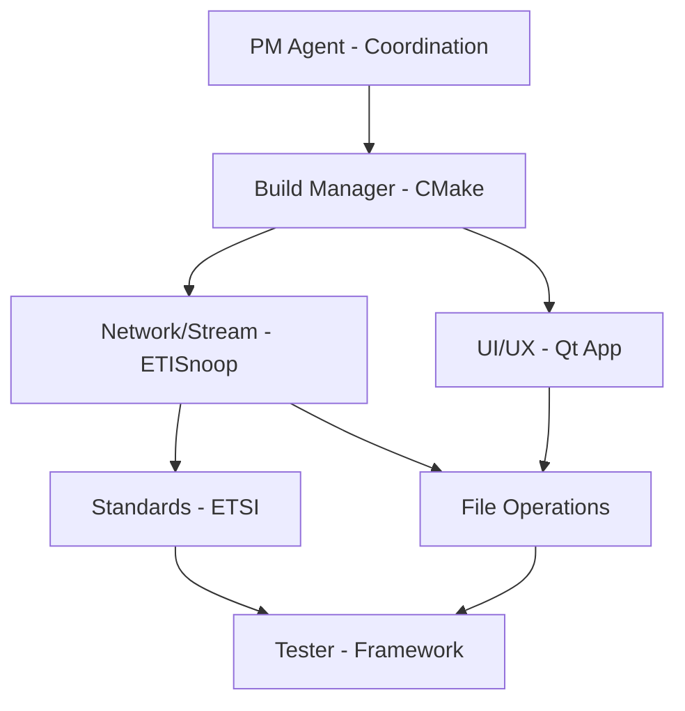

# PROJECT_STATUS.md - ETI Stream Analyzer Professional Desktop Application

**Last Updated:** September 19, 2025  
**Project Manager:** PM Agent  
**Current Phase:** Phase 1 - Foundation (Reality Assessment Complete)  
**Overall Progress:** 20% (Architectural Foundation Established)  
**CRITICAL STATUS:** **MAJOR DOCUMENTATION CORRECTION - REALITY ASSESSMENT COMPLETE**

## 🚨 PROJECT REALITY ASSESSMENT COMPLETE

### **CRITICAL FINDING:** Major Documentation-Reality Gap Identified

The **PM Agent** has completed a comprehensive audit revealing significant overclaiming in project documentation. Previous "95% complete" claims have been corrected to reflect actual ~20% foundational status.

### **Phase 1: Foundation Stabilization (September 19 - November 19, 2025)**

**PHASE OBJECTIVE:** 🔄 **IN PROGRESS** - Establish genuinely working foundation

**Foundation Completion Status:** 20% (Architecture established, implementation required)

| **Priority** | Agent | **Deliverable** | Target Date | Status |
|--------------|-------|-----------------|-------------|---------|
| **1st - CRITICAL** | Build Manager | Fix compilation errors | Sep 20 | 🔴 **BLOCKING** |
| **2nd - FOUNDATION** | Standards Compliance | Basic ETI processor implementation | Sep 27 | ⏸️ **WAITING** |
| **3rd - GUI** | UI/UX | Minimal functional GUI | Oct 4 | ⏸️ **WAITING** |
| **4th - TESTING** | Tester | Real test framework (replace placeholders) | Oct 11 | ⏸️ **WAITING** |
| **5th - INTEGRATION** | Network/Stream | End-to-end data flow | Oct 18 | ⏸️ **WAITING** |
| **6th - VALIDATION** | PM Agent | Phase 1 completion validation | Oct 25 | ⏸️ **WAITING** |

**🚨 CRITICAL BLOCKER:** Build system has compilation errors preventing all development

**Corrected Phase 1 Success Criteria:**
- [ ] **Build System Stable:** Zero compilation errors and warnings
- [ ] **Basic ETI Processing:** Can open and parse ETI files
- [ ] **Minimal GUI:** Functional main window with file operations
- [ ] **Real Test Framework:** 20+ actual test cases replacing placeholders
- [ ] **End-to-End Data Flow:** File → Processor → GUI working
- [ ] **Quality Assurance:** Evidence-based progress tracking established
- [ ] **Documentation Accuracy:** All claims backed by working implementations
- [ ] **Agent Coordination:** Clear responsibilities and realistic timelines
- [ ] **Performance Baseline:** Measurable performance targets established
- [ ] **Phase 2 Readiness:** Foundation stable enough for advanced features

## 🔄 TDD Implementation Milestones & Progress Tracking

### **Week 1: September 17-24, 2025 - TDD INFRASTRUCTURE SETUP**
**NEW FOCUS:** Testing framework infrastructure establishment (RED PHASE)

**Monday, September 17:**
- [x] **PM Agent:** TDD reorganization planning and documentation
- [ ] **Tester Agent (NEW LEAD):** Google Test framework setup
- [ ] **Tester Agent:** Qt Test framework integration

**Tuesday-Friday TDD Plan:**
- [ ] **Tester Agent:** Google Mock (gmock) framework setup
- [ ] **Build Manager:** CMake testing integration
- [ ] **Standards Compliance:** ETSI test specifications definition
- [ ] **Network/Stream:** Mock ETI stream data creation
- [ ] **UI/UX:** Qt Test framework for GUI components

### **Week 2: September 25 - October 1, 2025 - TDD GREEN PHASE**
**NEW FOCUS:** Minimal implementation to make tests pass

**TDD Deliverables (Test-First Approach):**
- [ ] **Red Phase Complete:** All tests written and initially failing
- [ ] **Green Phase:** Minimal code implementation to pass tests
- [ ] **Refactor Phase:** Code improvement while maintaining test success
- [ ] **Quality Gates:** 80% code coverage enforcement active
- [ ] **TDD Workflow:** Red-Green-Refactor cycle proven operational

## 👥 TDD Agent Coordination Matrix (REORGANIZED)

### **NEW TDD-Based Agent Assignments**

| Agent | **NEW TDD Role** | **TDD Priority** | **TDD-Specific Task** | Dependencies |
|-------|------------------|------------------|----------------------|--------------|
| **Tester Agent** | **TDD LEAD COORDINATOR** | **1st** | Testing framework setup & TDD enforcement | None |
| **Build Manager** | **TDD Build Integration** | **2nd** | CMake testing integration & coverage tools | Tester Agent |
| **Standards Compliance** | **TDD Test Specifications** | **3rd** | ETSI testable requirements definition | Tester Agent |
| **Network/Stream** | **TDD Test Data Provider** | **4th** | Mock ETI streams & test data creation | Standards + Tester |
| **UI/UX** | **GUI TDD Implementation** | **5th** | Qt Test framework for GUI components | Build Manager |
| **PM Agent** | **TDD Compliance Officer** | **6th** | TDD methodology enforcement & quality gates | All Agents |

### **Agent Dependencies & Workflow**

## 🎯 Performance Targets & Quality Gates

### **Phase 1 Quality Gates**
- [ ] **Build Success:** All platforms compile without errors
- [ ] **Basic Functionality:** ETI file loads and displays YAML output
- [ ] **Code Quality:** Initial code structure follows professional standards
- [ ] **Testing Foundation:** Unit test framework operational
- [ ] **Integration Success:** ETISnoop + Qt working together

### **Performance Baselines to Establish**
- [ ] **Build Time:** Baseline measurement for optimization tracking
- [ ] **Application Startup:** Initial timing for < 3 second target
- [ ] **Memory Usage:** Baseline for < 150MB target
- [ ] **File Load Performance:** ETI file processing speed measurement

## ⚠️ Risk Management & Issues Tracking

### **Current Risks**

| Risk | Probability | Impact | Mitigation | Owner |
|------|-------------|--------|------------|-------|
| ETISnoop integration complexity | Medium | High | Early prototyping, agent coordination | Network/Stream Agent |
| Cross-platform build issues | Low | Medium | Gradual platform testing | Build Manager Agent |
| Qt 6.x learning curve | Low | Low | Agent specialization, documentation | UI/UX Agent |
| Agent coordination overhead | Low | Medium | Clear workflows, daily check-ins | PM Agent |

### **Issue Tracker**

**No active issues at project start**

*Issues will be tracked here as they arise during implementation*

## 📋 Next Actions & Priorities

### **Immediate Priorities (September 17-20, 2025)**

**HIGH PRIORITY:**
1. **Build Manager Agent:** Initialize CMake project with Qt 6.x detection
2. **Network/Stream Agent:** Acquire and analyze ETISnoop source code
3. **PM Agent:** Daily coordination and unblock any issues

**MEDIUM PRIORITY:**
4. **UI/UX Agent:** Research Qt 6.x best practices for professional desktop apps
5. **Standards Compliance Agent:** Study ETSI EN 300 799 specification
6. **Tester Agent:** Plan testing framework architecture

### **Week 1 Exit Criteria**
- [ ] CMake builds successfully on at least one platform
- [ ] ETISnoop source integrated and compiling
- [ ] Basic Qt application window displays
- [ ] Clear plan for Week 2 implementation

## 📈 Success Metrics Dashboard

### **Development Velocity**
- **Deliverables Completed:** 1/8 (12.5%)
- **On Schedule:** ✅ YES (Day 1 of 77)
- **Agent Productivity:** All agents assigned and active
- **Risk Level:** 🟢 LOW

### **Technical Health**
- **Build Status:** 🟡 Not yet established
- **Test Coverage:** 🟡 Not yet established
- **Code Quality:** 🟡 Not yet established
- **Integration Status:** 🟡 Not yet established

### **ETSI Compliance Tracking**
- **Standards Research:** 🟡 In planning
- **Compliance Framework:** 🟡 Not started
- **Validation Testing:** 🟡 Not started
- **Documentation:** 🟡 Framework established

## 🔄 Phase Transition Planning

### **Phase 1 → Phase 2 Transition (October 1, 2025)**

**Required Completion Criteria:**
- [ ] All Phase 1 deliverables completed and tested
- [ ] Cross-platform build verification successful
- [ ] Basic ETI file processing demonstrated
- [ ] Agent coordination workflows proven effective
- [ ] Phase 2 detailed planning completed

**Phase 2 Preparation Checklist:**
- [ ] Real-time processing architecture designed
- [ ] Professional GUI layout planned
- [ ] FIG analysis widget specification ready
- [ ] Audio monitoring requirements defined
- [ ] Performance testing strategy established

## 📞 Stakeholder Communication

### **Weekly Status Reports**
- **Format:** Weekly progress summary with metrics and blockers
- **Distribution:** Project documentation updates
- **Schedule:** Every Tuesday by PM Agent

### **Milestone Reviews**
- **Phase 1 Review:** October 1, 2025
- **Phase 2 Review:** October 29, 2025
- **Phase 3 Review:** November 12, 2025
- **Final Review:** December 3, 2025

### **Escalation Path**
1. **Agent-level Issues:** Resolve within agent specialization
2. **Cross-agent Dependencies:** PM Agent coordination
3. **Technical Blockers:** Multi-agent collaboration session
4. **Timeline Risks:** Phase scope adjustment consideration

---

**Next Update:** September 18, 2025  
**Responsibility:** PM Agent daily status maintenance  
**Critical Path:** Build Manager Agent CMake setup → Network/Stream Agent ETISnoop integration  

**Contact Information:**
- **Project Manager:** PM Agent (primary coordinator)
- **Technical Lead:** Network/Stream Agent (ETI processing expertise)
- **Build Master:** Build Manager Agent (cross-platform builds)
- **Quality Assurance:** Tester Agent (validation and testing)
