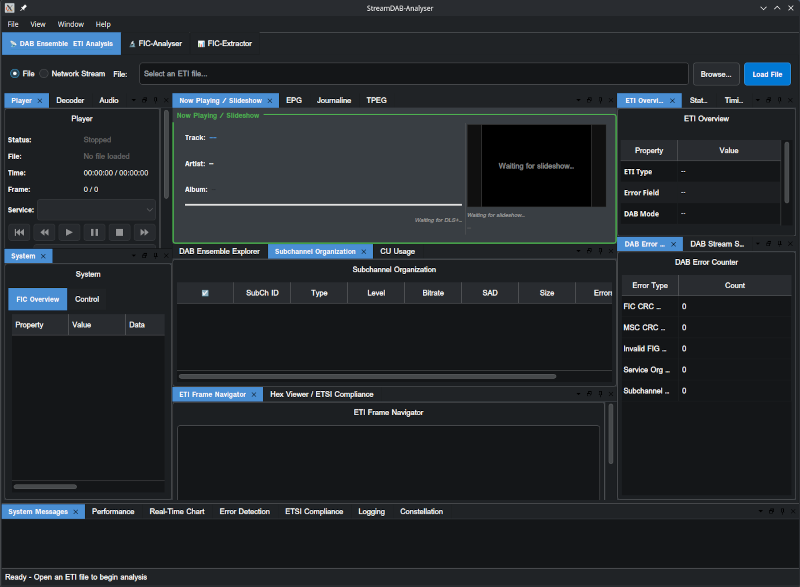

# StreamDAB Analyser

[](https://github.com/streamdab/streamdab-analyser/actions/workflows/ci.yml)
[](https://github.com/streamdab/streamdab-analyser/releases)
[](LICENSE)

A professional **DAB / DAB+ / ETI stream analyser** for broadcast engineers —
Qt 6 desktop GUI plus a scriptable CLI. It decodes and validates Ensemble
Transport Interface streams end to end: ETI framing, the FIC/FIG signalling
carousel, service and sub-channel discovery, DAB+ audio, PAD/DLS+ "now playing"
metadata, MOT slideshow and data services, with ETSI compliance checks.

> **Status:** first public release. CI builds and tests every change on Linux,
> Windows and macOS and publishes the installable packages as build artifacts.



## Download

Get the latest build from the **[Releases page](https://github.com/streamdab/streamdab-analyser/releases/latest)**.
Every file is listed in `SHA256SUMS.txt`.

| Platform | Package | Notes |
|---|---|---|
| **Windows 10/11 (x64)** | `StreamDAB-Analyser-windows-x86_64-setup.exe` (installer) or `windows-x86_64.zip` (portable) | Qt, plugins and the C++ runtime are included. GUI and CLI. |
| **macOS 12+ (Apple silicon)** | `macos-arm64.dmg` | Drag the app to *Applications*. GUI only; use the Linux/Windows package or build from source for the CLI. |
| **Linux x86-64 (Ubuntu 24.04 or newer)** | `StreamDAB-Analyser-linux-x86_64.AppImage`, `streamdab-analyser-linux-amd64.deb`, `linux-x86_64.tar.gz` | GUI and CLI. |

**These packages are not code-signed yet**, so the first start needs one extra step:

- **Windows:** SmartScreen may warn. Choose *More info*, then *Run anyway*.
- **macOS:** right-click the app, choose *Open*, then *Open* again — or run
  `xattr -dr com.apple.quarantine /Applications/StreamDAB-Analyser.app`.
- **Linux:** `chmod +x StreamDAB-Analyser-*.AppImage && ./StreamDAB-Analyser-*.AppImage`, or
  `sudo apt install ./streamdab-analyser-linux-amd64.deb`. A file manager shows
  a generic icon for an AppImage until it is integrated (AppImageLauncher,
  Gear Lever or appimaged); the `.deb` installs the menu entry and icon.

The x86-64 packages (Linux and Windows) are built for the baseline instruction set, so they run on any 64-bit PC.
Older Linux distributions than Ubuntu 24.04 (Qt 6.2) are not supported by the
binary packages; build from source instead.

## Features

**ETI and signalling**
- ETI(NI/LI) framing per ETSI EN 300 799 — sync, FCT, frame CRCs, error-frame
  reporting, sub-channel/ MSC demultiplexing, FIC extraction.
- Complete FIG decoding per ETSI EN 300 401 (FIG 0/1/2/3/… incl. service
  components, service labels, ensemble info, date/time, region, OE services,
  adjacent services, link information, and more) with a live FIG tracer.
- Service discovery with full metadata (service IDs incl. 32-bit data SIDs,
  labels, component types, bit rates, protection profiles) and per-service
  timelines.

**DAB+ audio and metadata**
- DAB+ superframe/AU handling, Reed–Solomon and CRC checks, HE-AAC decode via
  libfaad2 (audio levels, format reporting).
- **PAD/DLS+** decoding per ETSI TS 102 563 / TS 102 980 — structured
  now-playing tags (title/artist/album/…) plus plain DLS.
- **MOT slideshow** with real image extraction, plus **EPG, Journaline and
  TPEG** decoders that also feed the inner data-service tabs of the Now
  Playing panel (Slideshow | EPG | Journaline | TPEG). TPEG coverage is
  identification-level only — TS 102 894-1-style framing + a text inventory
  of the observed application, full TTI later. Every tab shows data only
  when the stream actually carries it: a capture with an idle EPG service or
  no Journaline carousel displays an explicit honest empty state ("No EPG
  data in this stream", "No Journaline data routed in this stream") instead
  of fabricated content.
- **Thai UTF-8** handling is a first-class requirement (labels, DLS+, EPG) and is
  covered by tests.
- Playback of the selected service's decoded audio: ALSA on Linux, Qt
  Multimedia (`QAudioSink`) on Windows/macOS.

**Live input**
- Local ETI files (ETI-NI / ETI-LI), **UDP** (with FEC/PFT reassembly), **TCP**
  (`tcp://host:port`), and **ZeroMQ** (`zmq+tcp://host:port`, e.g. an
  ODR-DabMux publisher).

**Tooling**
- Qt 6 GUI with an advanced docking layout (Qt-ADS): 27 docks across transport,
  FIC analyser, service tree, hex viewer, FIG tracer, constellation, spectrum,
  performance dashboard, compliance monitor and logging panels.
- `streamdab-cli` headless analyser with YAML output (ETI stream stats, service
  inventory, FIG inventory, FIC health, DLS+/MOT counters) for scripts and CI.
- ETSI compliance verdicts (FIC/FIB CRC, erroneous FIGs, mandatory FIG
  coverage) reported separately from transport error frames.

## Requirements

| | Linux | Windows | macOS |
|---|---|---|---|
| Toolchain | gcc/clang + system Qt 6 | MSVC 2022 + aqt Qt 6 + vcpkg | Apple clang + Homebrew Qt 6 |
| Speed-up libs | libfaad2, libfftw3, libzmq | vcpkg: faad2, fftw3, zeromq, cppzmq | brew: faad2, fftw, zeromq, cppzmq |
| Audio out | ALSA | Qt Multimedia | Qt Multimedia |

All optional dependencies are detected portably and degrade gracefully: build
without ZeroMQ (`-DDABX_ENABLE_ZMQ=OFF`), without ALSA
(`-DDABX_ENABLE_ALSA=OFF`) or without Qt Multimedia
(`-DDABX_ENABLE_QMULTIMEDIA=OFF`) and the analyser still builds, with the
corresponding feature reported as unavailable.

## Build from source

Full instructions (prerequisites per OS, presets, troubleshooting, packaging)
are in **[INSTALL.md](INSTALL.md)**. The short version:

```bash
# Linux
sudo apt-get install -y cmake qt6-base-dev libfaad-dev libfftw3-dev libzmq3-dev \
  qt6-base-private-dev libxkbcommon-dev libxkbcommon-x11-dev build-essential
export QT_QPA_PLATFORM=offscreen          # before configure: registers the GUI tests
cmake --preset linux-gcc
cmake --build --preset build-linux        # RAM-safe job cap (never a bare -j)
ctest --preset test-linux
```

Windows: `cmake --preset windows-msvc` with `VCPKG_ROOT` set.
macOS: `export QT_DIR="$(brew --prefix qt@6)"` then `cmake --preset macos-brew`.

The build has **zero warnings** as a hard rule; the version string comes from the
git tag (`DABX_VERSION`), so a tagged checkout reports its own version.

## Run

```bash
# GUI
./build/StreamDABAnalyser                          # open an ETI file from the File menu
# installed packages: start "StreamDAB Analyser" from the menu, or `StreamDABAnalyser`

# CLI (headless, YAML report)
./build/streamdab-cli --input capture.eti --output report.yaml
./build/streamdab-cli --help

# Live streams
#   UDP:  udp://@239.1.1.1:5000      (optional FEC/PFT)
#   TCP:  tcp://host:9000
#   ZMQ:  zmq+tcp://host:9000
```

## Testing

```bash
cd build && QT_QPA_PLATFORM=offscreen ctest -L PUBLIC --output-on-failure   # public suite
# full suite (needs the private captures): ctest --output-on-failure
```

The suite covers ETI/FIG/CRC parsing, service discovery, DLS+/MOT/EPG decoding,
charset (Thai) handling, networking (UDP/TCP/ZeroMQ loopback), audio decode and
output lifecycle, settings persistence and the GUI docking layout.

The test targets are split into two labelled suites (`ctest -L PUBLIC` /
`ctest -L PRIVATE`):

- **PUBLIC** — self-contained tests; this is what GitHub CI runs.
- **PRIVATE** — end-to-end tests against real broadcast captures
  (for example a Bangkok capture). Those captures are **World DAB
  licensed test material and are not part of this repository**: the
  private suite runs on machines that have the capture files present locally
  (e.g. by cloning the private origin). The parity gate they drive — DLS+ 1114 /
  PAD 1114, MOT 97 objects / 97 images, 16 services, Thai labels, 0 CRC
  warnings on the Bangkok capture — is a local gate.

## Project layout

```
src/core/     ETI/FIG parsing, service discovery, DAB+/MOT/EPG decoding, audio
src/gui/      Qt widgets (About, settings, dashboard, charts, constellation)
src/network/  UDP/TCP/ZeroMQ streaming, circular buffers, playback
src/cli/      headless analyser and YAML report generator
src/utils/    logging, settings, helpers
tests/        unit, integration and GUI suites (ctest)
resources/    desktop entry, MIME definition, icons (SVG/PNG/ICO/ICNS)
packaging/    Debian/NSIS/macOS templates + AppImage and .dmg helpers
cmake/        CPack packaging configuration
docs/         release notes and design notes
```

## Licence

**GNU General Public License v3.0 or later** — see [LICENSE](LICENSE).
Third-party components, reference implementations and standards are credited in
**[ATTRIBUTIONS.md](ATTRIBUTIONS.md)**.

## Contributing

Issues and pull requests are welcome. Please keep the build warning-free and
the test suite green (`ctest -L PUBLIC` on CI; the full suite locally with the
private captures), and follow the
existing Qt/C++20 style.
