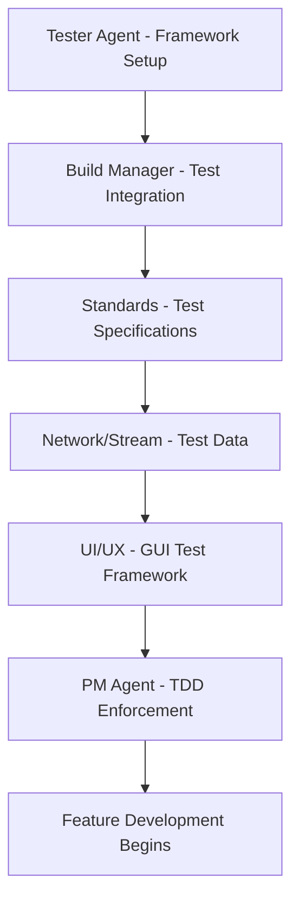

# TDD Implementation Plan - ETI Stream Analyzer Professional Desktop Application

**Document Version:** 1.0  
**Date:** September 17, 2025  
**Author:** PM Agent  
**Critical Priority:** IMMEDIATE IMPLEMENTATION REQUIRED  

## 🚨 URGENT: TDD Methodology Reorganization

This document implements the MANDATORY reorganization of all agent tasks to align with Test-Driven Development (TDD) methodology as specified in CLAUDE.md. All previous development approaches are SUPERSEDED by this TDD-first strategy.

## 📋 TDD Reorganization Executive Summary

### Current Status Assessment
- **Project Phase:** Phase 1 - Foundation (Week 1-2)
- **Current Progress:** 5% (Documentation only)
- **TDD Readiness:** 0% (No testing infrastructure established)
- **CRITICAL FINDING:** Development must HALT until TDD framework is operational

### Immediate Action Required
1. **STOP** all feature implementation until TDD framework is complete
2. **PRIORITIZE** testing infrastructure across all agents
3. **ESTABLISH** Red-Green-Refactor workflow enforcement
4. **MANDATE** 80% code coverage before any feature completion
5. **IMPLEMENT** quality gates preventing non-tested code commits

## 🔄 TDD Implementation Strategy

### TDD Cycle Enforcement
```
🔴 RED Phase: Write Failing Test
├── Define test specification
├── Create minimal failing test
├── Verify test fails for correct reason
└── Document expected behavior

🟢 GREEN Phase: Make Test Pass
├── Write minimal code to pass test
├── Avoid over-engineering
├── Focus on test satisfaction only
└── Verify test passes

🔵 REFACTOR Phase: Improve Code
├── Improve code structure
├── Maintain test passing status
├── Apply design patterns
└── Optimize performance

🔄 REPEAT: Next Feature Cycle
```

### Quality Gates (MANDATORY)
- **Pre-Commit:** All tests must pass
- **Code Coverage:** Minimum 80% required
- **Integration:** Full test suite execution
- **Performance:** Benchmark validation
- **Compliance:** ETSI standards testing

## 👥 Agent Task Reorganization Matrix

### **Phase 1 TDD Setup (Week 1-2) - CURRENT PRIORITY**

| Agent | Original Priority | **NEW TDD Priority** | TDD-Specific Tasks | Dependencies |
|-------|------------------|---------------------|-------------------|--------------|
| **Tester Agent** | 6th (Testing) | **1st (LEAD ROLE)** | Set up gtest, Qt Test, gmock frameworks | None |
| **Build Manager** | 2nd (CMake) | **2nd (TDD Integration)** | Integrate testing into build system | Tester Agent |
| **Standards Compliance** | 5th (ETSI) | **3rd (Test Specifications)** | Define testable ETSI requirements | Tester Agent |
| **Network/Stream** | 3rd (ETISnoop) | **4th (Test Data)** | Create mock ETI streams and test data | Standards + Tester |
| **UI/UX** | 4th (Qt GUI) | **5th (GUI Testing)** | Establish Qt Test framework | Build Manager |
| **PM Agent** | 1st (Coordination) | **6th (TDD Enforcement)** | Enforce TDD methodology compliance | All Agents |

### **Critical Path - TDD Framework Implementation**



## 🧪 TDD Framework Implementation Roadmap

### **Week 1: Testing Infrastructure Foundation**

#### **Day 1-2: Tester Agent Lead (CRITICAL)**
**NEW ROLE: TDD Coordinator & Framework Lead**

```cpp
// IMMEDIATE DELIVERABLES
class TDDFrameworkSetup {
public:
    // Core testing frameworks
    bool setup_google_test_framework();        // Unit testing
    bool setup_qt_test_framework();           // GUI testing
    bool setup_google_mock_framework();       // Mocking
    bool setup_coverage_tools();              // gcov/lcov
    bool create_ci_pipeline();                // Automated testing
    
    // TDD enforcement tools
    bool create_pre_commit_hooks();           // Prevent untested commits
    bool setup_quality_gates();              // 80% coverage enforcement
    bool create_test_templates();             // Standardized test structure
    bool establish_tdd_workflow();            // Red-Green-Refactor cycle
    
    // Test data management
    bool setup_test_data_directory();        // Test assets organization
    bool create_mock_eti_streams();          // ETI test data
    bool setup_test_fixtures();              // Reusable test components
};
```

**TDD Success Criteria (Day 2):**
- [ ] Google Test compiles and executes
- [ ] Qt Test framework operational
- [ ] Google Mock available for dependency isolation
- [ ] Code coverage reporting functional
- [ ] Pre-commit hooks block untested code

#### **Day 3-4: Build Manager Agent (TDD Integration)**
**UPDATED PRIORITY: Testing-First Build System**

```cmake
# CMakeLists.txt - TDD Integration Required
cmake_minimum_required(VERSION 3.20)
project(ETIStreamAnalyzer)

# MANDATORY: Enable testing from start
enable_testing()

# TDD Framework Integration
find_package(GTest REQUIRED)
find_package(Qt6 COMPONENTS Test REQUIRED)
find_package(GMock REQUIRED)

# Coverage tools setup
option(ENABLE_COVERAGE "Enable coverage reporting" ON)
if(ENABLE_COVERAGE)
    add_compile_options(--coverage)
    add_link_options(--coverage)
endif()

# Test-driven build targets
add_subdirectory(tests)           # Test directory first priority
add_subdirectory(src)             # Source code second priority

# Quality gates
add_custom_target(run_tests
    COMMAND ctest --output-on-failure
    DEPENDS all_tests
)

add_custom_target(coverage_report
    COMMAND lcov --capture --directory . --output-file coverage.info
    COMMAND genhtml coverage.info --output-directory coverage_html
    DEPENDS run_tests
)

# Pre-commit enforcement
add_custom_target(pre_commit_check
    COMMAND ${CMAKE_COMMAND} --build . --target run_tests
    COMMAND ${CMAKE_COMMAND} --build . --target coverage_report
)
```

**Build System Success Criteria (Day 4):**
- [ ] CMake generates with testing enabled
- [ ] All testing frameworks linked properly
- [ ] Coverage reporting operational
- [ ] Quality gates prevent untested builds

#### **Day 5-7: Standards Compliance Agent (Test Specifications)**
**UPDATED PRIORITY: Testable ETSI Requirements**

```cpp
// ETSI_TEST_SPECIFICATIONS.cpp
class EtsiComplianceTestSuite {
public:
    // RED Phase: Define failing tests for ETSI requirements
    TEST(EtsiEN300799Test, EtiFrameStructureCompliance) {
        // Test ETI frame: 6144 bytes, 24ms timing
        EtiFrame frame = create_test_frame();
        EXPECT_EQ(frame.size(), 6144);
        EXPECT_EQ(frame.duration_ms(), 24);
        EXPECT_TRUE(validate_sync_pattern(frame));
        // INITIALLY FAILS - No implementation yet
    }
    
    TEST(EtsiEN300401Test, FigAnalysisCompliance) {
        // Test FIG decoding accuracy
        std::vector<FigBlock> figs = create_test_figs();
        FigAnalyzer analyzer;
        auto results = analyzer.analyze(figs);
        EXPECT_GT(results.ensemble_count(), 0);
        EXPECT_GT(results.service_count(), 0);
        // INITIALLY FAILS - No FIG analyzer yet
    }
    
    TEST(EtsiEN302077Test, AudioDecodingCompliance) {
        // Test DAB+ audio decoding
        AudioData test_audio = create_test_audio();
        AudioDecoder decoder;
        auto decoded = decoder.decode(test_audio);
        EXPECT_TRUE(decoded.is_valid());
        EXPECT_EQ(decoded.sample_rate(), 48000);
        // INITIALLY FAILS - No audio decoder yet
    }
};
```

**Standards Testing Success Criteria (Day 7):**
- [ ] ETSI test specifications defined
- [ ] All tests initially FAIL (Red phase)
- [ ] Test data and fixtures created
- [ ] Compliance validation framework ready

### **Week 2: TDD Implementation & Green Phase**

#### **Day 8-10: Network/Stream Agent (Test Data & Mocks)**
**UPDATED PRIORITY: ETI Stream Test Infrastructure**

```cpp
// ETI_STREAM_TEST_MOCKS.cpp
class MockEtiStreamProcessor {
public:
    // Mock ETI stream generation
    std::vector<EtiFrame> generate_compliant_stream(size_t frame_count) {
        std::vector<EtiFrame> frames;
        for (size_t i = 0; i < frame_count; ++i) {
            frames.push_back(create_compliant_frame(i));
        }
        return frames;
    }
    
    // Mock error scenarios
    std::vector<EtiFrame> generate_error_stream(ErrorType error_type) {
        auto frames = generate_compliant_stream(100);
        inject_error(frames, error_type);
        return frames;
    }
    
    // Performance test data
    std::vector<EtiFrame> generate_performance_stream(size_t target_fps) {
        return generate_high_volume_stream(target_fps * 5); // 5 second test
    }
};

class EtiStreamProcessorTests {
public:
    TEST(EtiStreamTest, ProcessComplianceStream) {
        MockEtiStreamProcessor mock;
        auto test_stream = mock.generate_compliant_stream(1000);
        
        EtiStreamProcessor processor;
        auto result = processor.process(test_stream);
        
        EXPECT_TRUE(result.success);
        EXPECT_EQ(result.frames_processed, 1000);
        EXPECT_GT(result.processing_fps, 900); // Performance requirement
    }
};
```

**Stream Testing Success Criteria (Day 10):**
- [ ] Mock ETI streams created
- [ ] Test data generation operational
- [ ] Performance test scenarios ready
- [ ] Error injection capabilities functional

#### **Day 11-12: UI/UX Agent (GUI Test Framework)**
**UPDATED PRIORITY: Qt Test Integration**

```cpp
// GUI_COMPONENT_TESTS.cpp
class MainWindowTests : public QObject {
    Q_OBJECT
    
private slots:
    void test_window_initialization() {
        MainWindow window;
        window.show();
        
        QVERIFY(window.isVisible());
        QVERIFY(window.findChild<QMenuBar*>() != nullptr);
        QVERIFY(window.findChild<QStatusBar*>() != nullptr);
        // INITIALLY FAILS - No MainWindow implementation
    }
    
    void test_eti_file_loading() {
        MainWindow window;
        QString test_file = ":/test_data/sample.eti";
        
        bool loaded = window.loadEtiFile(test_file);
        QVERIFY(loaded);
        QVERIFY(!window.getCurrentEtiData().isEmpty());
        // INITIALLY FAILS - No file loading implementation
    }
    
    void test_real_time_display_updates() {
        MainWindow window;
        MockEtiStreamProcessor mock;
        
        auto test_stream = mock.generate_compliant_stream(100);
        window.setRealTimeStream(test_stream);
        
        QTest::qWait(1000); // Wait for updates
        QVERIFY(window.getDisplayedFrameCount() > 0);
        // INITIALLY FAILS - No real-time display
    }
};
```

**GUI Testing Success Criteria (Day 12):**
- [ ] Qt Test framework integrated
- [ ] GUI component tests defined
- [ ] Mock data integration working
- [ ] All GUI tests initially FAIL (Red phase)

#### **Day 13-14: PM Agent (TDD Enforcement)**
**UPDATED ROLE: TDD Compliance Officer**

```bash
#!/bin/bash
# pre-commit-tdd-enforcement.sh

echo "🔴 TDD Enforcement: Running pre-commit checks..."

# Run all tests
if ! make run_tests; then
    echo "❌ COMMIT BLOCKED: Tests are failing"
    echo "TDD Requirement: All tests must pass before commit"
    exit 1
fi

# Check code coverage
COVERAGE=$(make coverage_report | grep "lines" | awk '{print $2}' | tr -d '%')
if (( $(echo "$COVERAGE < 80" | bc -l) )); then
    echo "❌ COMMIT BLOCKED: Code coverage is ${COVERAGE}% (minimum 80% required)"
    echo "TDD Requirement: Write more tests to increase coverage"
    exit 1
fi

# Verify TDD cycle compliance
if ! check_tdd_cycle_compliance; then
    echo "❌ COMMIT BLOCKED: TDD cycle not followed"
    echo "Required: Red -> Green -> Refactor cycle"
    exit 1
fi

echo "✅ TDD Compliance: All checks passed"
echo "🟢 GREEN PHASE: Commit allowed"
```

**TDD Enforcement Success Criteria (Day 14):**
- [ ] Pre-commit hooks operational
- [ ] 80% coverage enforcement active
- [ ] TDD cycle validation functional
- [ ] Quality gates prevent non-TDD commits

## 🎯 TDD Implementation Success Metrics

### **Week 1 Exit Criteria (September 24, 2025)**
- [ ] **Test Frameworks Operational**: gtest, Qt Test, gmock functional
- [ ] **Build System TDD-Ready**: CMake with testing integration
- [ ] **All Tests RED**: Comprehensive failing test suite exists
- [ ] **Quality Gates Active**: Pre-commit hooks prevent untested code
- [ ] **Coverage Reporting**: lcov/gcov generating reports
- [ ] **Mock Data Ready**: ETI streams and test fixtures available

### **Week 2 Exit Criteria (October 1, 2025)**
- [ ] **GREEN Phase Success**: Core tests passing with minimal implementation
- [ ] **80% Coverage Achieved**: Code coverage minimum requirement met
- [ ] **TDD Workflow Proven**: Red-Green-Refactor cycle demonstrated
- [ ] **Agent Coordination**: All agents following TDD methodology
- [ ] **CI/CD Pipeline**: Automated testing operational
- [ ] **Feature Development Ready**: TDD foundation supports feature work

### **Quality Assurance Metrics**
- **Test Coverage**: Minimum 80% (Target: 85%+)
- **Test Execution Time**: < 5 minutes for full suite
- **Test Reliability**: > 99% consistent pass/fail results
- **TDD Cycle Compliance**: 100% (no feature code without tests)
- **Performance Test Integration**: ETI processing benchmarks operational

## 🚨 Risk Mitigation & Contingency Plans

### **Critical Risk: TDD Learning Curve**
- **Mitigation**: Dedicated TDD training and pair programming
- **Contingency**: External TDD consultant if needed
- **Timeline Impact**: Additional 2-3 days budgeted

### **Critical Risk: Testing Framework Integration Issues**
- **Mitigation**: Test framework compatibility verification
- **Contingency**: Alternative framework selection (catch2, boost.test)
- **Timeline Impact**: Maximum 1 week delay acceptable

### **Critical Risk: Performance Testing Complexity**
- **Mitigation**: Simple benchmark tests initially, complex tests later
- **Contingency**: Manual performance validation if automated tests fail
- **Timeline Impact**: Performance tests can be delayed to Week 3

## 📈 TDD Success Validation

### **Daily TDD Health Checks**
```bash
# Daily TDD status validation
./scripts/check_tdd_health.sh

# Outputs:
# ✅ Test frameworks operational
# ✅ All tests pass
# ✅ Coverage > 80%
# ✅ TDD cycle compliance
# ✅ Quality gates active
# 📊 TDD Health Score: 95%
```

### **TDD Compliance Dashboard**
- **Red Phase Compliance**: % of features starting with failing tests
- **Green Phase Efficiency**: Time from red to green
- **Refactor Phase Quality**: Code improvement metrics
- **Overall TDD Score**: Weighted compliance metric

## 🎯 Next Phase Transition

### **Phase 1 → Phase 2 Transition Criteria**
- [ ] **TDD Framework Complete**: All testing infrastructure operational
- [ ] **Agent TDD Adoption**: All agents using TDD methodology
- [ ] **Quality Gates Validated**: Pre-commit hooks preventing regressions
- [ ] **Performance Baseline**: ETI processing benchmarks established
- [ ] **Feature Development Ready**: TDD foundation supports feature work

### **Phase 2 TDD Implementation**
Once Phase 1 TDD setup is complete, Phase 2 will implement:
- **Real-time Processing TDD**: Test-driven ETI stream processing
- **GUI Component TDD**: Professional interface with comprehensive testing
- **ETSI Compliance TDD**: Standards validation through testing
- **Performance Optimization TDD**: Benchmark-driven improvements

---

## 🚀 IMMEDIATE NEXT ACTIONS

1. **HALT** all current feature implementation
2. **ASSIGN** Tester Agent as TDD Lead effective immediately
3. **PRIORITIZE** testing framework setup across all agents
4. **ESTABLISH** daily TDD compliance reviews
5. **ENFORCE** 80% code coverage requirement
6. **IMPLEMENT** quality gates preventing non-tested commits

**Success Definition**: No feature implementation proceeds without comprehensive TDD framework completion.

**Timeline**: TDD framework must be operational within 14 days (October 1, 2025).

**Quality Standard**: Professional broadcast industry testing standards with ETSI compliance validation.