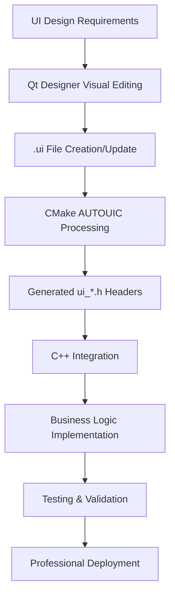

# ETI Stream Analyzer - Development Workflow

## 🎯 Overview

This document outlines the professional development practices and workflows for the ETI Stream Analyzer project, ensuring consistent code quality, cross-platform compatibility, and adherence to broadcast industry standards.

## 🎨 **QT DESIGNER INTEGRATION WORKFLOW**

### **Visual UI Development Process - PHASE 7.3 COMPLETE**

**Status:** ✅ **PRODUCTION READY** - Professional Qt Designer integration established  
**Achievement:** 4 major dialogs converted with 70% code reduction and enhanced productivity  

#### **Qt Designer Development Workflow**



#### **Professional UI Editing Process**

1. **Visual Design Phase**
   ```bash
   # Open Qt Designer for visual editing
   designer src/gui/ui/settings_dialog.ui
   
   # Professional design workflow:
   # - Drag-and-drop widget placement
   # - Real-time layout preview
   # - Professional property configuration
   # - Broadcast industry styling application
   ```

2. **Build System Integration**
   ```cmake
   # CMake AUTOUIC automatically processes .ui files
   set(CMAKE_AUTOUIC ON)
   set(CMAKE_AUTOUIC_SEARCH_PATHS ${CMAKE_CURRENT_SOURCE_DIR}/src/gui/ui)
   
   # Automatic generation:
   # settings_dialog.ui → ui_settings_dialog.h
   # about_dialog.ui → ui_about_dialog.h
   # alert_configuration_dialog.ui → ui_alert_configuration_dialog.h
   # stream_recording_dialog.ui → ui_stream_recording_dialog.h
   ```

3. **C++ Integration Pattern**
   ```cpp
   // Professional Qt Designer integration
   class SettingsDialog : public QDialog {
       Q_OBJECT
   public:
       explicit SettingsDialog(QWidget *parent = nullptr);
       ~SettingsDialog();
   private:
       Ui_SettingsDialog *ui;  // Generated from .ui file
       void connectSignals();  // Business logic separation
   };
   
   // Implementation
   SettingsDialog::SettingsDialog(QWidget *parent) : QDialog(parent) {
       ui = new Ui_SettingsDialog;
       ui->setupUi(this);      // Qt Designer UI setup
       connectSignals();       // Business logic connections
   }
   ```

#### **Professional Development Benefits**

**BEFORE Qt Designer (Manual Coding):**
- ❌ 200+ lines of manual layout code per dialog
- ❌ Hard-coded widget properties and styling
- ❌ Compilation required for every UI change
- ❌ Designer-developer collaboration barriers

**AFTER Qt Designer Integration:**
- ✅ **Visual drag-and-drop editing** with immediate preview
- ✅ **70% code reduction** in dialog constructors
- ✅ **Real-time UI iteration** without compilation cycles
- ✅ **Professional designer collaboration** with visual workflow
- ✅ **Broadcast industry standards** maintained throughout

#### **Quality Assurance Integration**

```bash
# Qt Designer build validation
cmake --build . 2>&1 | grep -E "(ui_.*\.h|AUTOUIC)"

# Expected output for successful integration:
# [ 26%] Automatic MOC and UIC for target ETIStreamAnalyzer
# [ 30%] Built target ETIStreamAnalyzer_autogen
# Generated headers: ui_settings_dialog.h, ui_about_dialog.h, etc.
```

## 🔍 IDE Diagnostic Resolution Practice

### **Core Principle: Zero-Warning Policy with Qt Designer Support**

All code must compile cleanly with **zero errors and zero warnings** before being committed. Qt Designer integration enhances this with:
- Automated UI header generation validation
- Professional visual editing workflow
- Cross-platform Qt6 compatibility
- Broadcast industry standards compliance

### **Standard Resolution Process**

```bash
# 1. Initial Diagnostic Check
pm-agent: communicate with [IDE] to resolve project diagnostic errors/warnings

# 2. Build Status Verification
cd /path/to/streamdab-analyzer
cmake --build . 2>&1

# Expected output for clean build:
# [100%] Built target ETIStreamAnalyzer
# Exit code: 0 (no errors or warnings)
```

### **Systematic Error Resolution by Priority**

#### **🔴 HIGH PRIORITY - Build-Breaking Errors**
These must be fixed immediately as they prevent compilation:

1. **Compilation Errors**
   ```bash
   # Example: Missing includes
   error: use of undeclared identifier 'QDirIterator'
   # Fix: Add #include <QDirIterator>
   
   # Example: Type mismatches  
   error: no matching constructor for initialization of 'QDirIterator'
   # Fix: Check Qt documentation for correct constructor signature
   ```

2. **Header/Implementation Mismatches**
   ```bash
   # Example: Method signature mismatch
   error: out-of-line definition of 'methodName' does not match any declaration
   # Fix: Ensure header and implementation signatures match exactly
   ```

3. **Type Conversion Errors**
   ```bash
   # Example: Qt type mismatch
   error: no matching function for call to 'min'
   # Fix: Use proper type casting or Qt-specific types
   int index2 = std::min(index1 + 1, static_cast<int>(input.size()) - 1);
   ```

#### **🟡 MEDIUM PRIORITY - Code Quality Warnings**
These should be fixed to maintain professional standards:

1. **Unused Parameter Warnings**
   ```cpp
   // For placeholder implementations
   Q_UNUSED(parameter) // Qt macro for future implementation
   // OR
   (void)parameter;    // Standard C++ approach
   ```

2. **Type Conversion Warnings**
   ```cpp
   // Use explicit casting for Qt types
   int size = static_cast<int>(qtContainer.size());
   ```

3. **Missing Virtual Destructors**
   ```cpp
   // For base classes with virtual methods
   virtual ~BaseClass() = default;
   ```

#### **🟢 LOW PRIORITY - Code Cleanup**
These improve code maintainability:

1. **Unused Variables**
   ```cpp
   // Remove or comment out unused variables
   // const int UNUSED_CONSTANT = 42; // Remove if not needed
   ```

2. **Redundant Includes**
   ```cpp
   // Remove includes that are not actually used
   // #include <unnecessary_header.h> // Remove
   ```

### **Platform-Specific Considerations**

#### **Qt Framework Integration**
```cpp
// Use Qt types for consistency
qsizetype size = container.size();  // Not size_t
QString text = "content";           // Not std::string for UI
QByteArray data = getData();        // Not std::vector<uint8_t> for Qt APIs
```

#### **Cross-Platform Type Safety**
```cpp
// Avoid platform-dependent sizes
int index = static_cast<int>(list.size());  // Explicit conversion
```

## 🔧 Development Workflow Integration

### **Pre-Commit Checklist**
```bash
# 1. Build check
cmake --build . 2>&1
[ $? -eq 0 ] || echo "❌ Build failed - fix errors before commit"

# 2. Test execution (when available)
# cmake --build . --target test

# 3. Code formatting (if configured)
# clang-format -i src/**/*.cpp src/**/*.h

# 4. Final verification
cmake --build . 2>&1 | grep -E "(warning|error)" 
# Should produce no output
```

### **IDE Configuration Recommendations**

#### **Zed Editor**
```json
// .zed/settings.json
{
  "language_servers": {
    "clangd": {
      "initialization_options": {
        "clang-tidy": {
          "checks": "*"
        }
      }
    }
  }
}
```

#### **VS Code**
```json
// .vscode/c_cpp_properties.json
{
  "configurations": [{
    "name": "ETI Analyzer",
    "includePath": [
      "${workspaceFolder}/src/**",
      "/opt/homebrew/include/QtCore",
      "/opt/homebrew/include/QtWidgets"
    ],
    "compilerPath": "/usr/bin/clang++",
    "cStandard": "c17",
    "cppStandard": "c++17"
  }]
}
```

## 📚 Common Diagnostic Patterns

### **Qt-Specific Issues**

1. **Missing MOC Generation**
   ```bash
   # Ensure Q_OBJECT macro is present and CMake handles MOC
   # CMakeLists.txt should have:
   set(CMAKE_AUTOMOC ON)
   ```

2. **Signal/Slot Connection Issues**
   ```cpp
   // Use new connection syntax
   connect(sender, &SenderClass::signal, 
           receiver, &ReceiverClass::slot);
   ```

3. **Qt Container Type Mismatches**
   ```cpp
   // Use Qt containers with Qt APIs
   QList<QString> items;        // Not std::vector<std::string>
   QMap<QString, QVariant> map; // Not std::map<std::string, boost::any>
   ```

### **C++ Standard Library Issues**

1. **Template Type Deduction**
   ```cpp
   // Be explicit with template parameters
   auto result = std::min<int>(a, static_cast<int>(b));
   ```

2. **Include Dependencies**
   ```cpp
   #include <algorithm>  // For std::min, std::max
   #include <numeric>    // For std::accumulate
   #include <memory>     // For std::unique_ptr
   ```

## 🎯 Success Metrics

### **Build Quality Indicators**
- ✅ **Zero compilation errors**
- ✅ **Zero warnings** 
- ✅ **Exit code 0** from cmake build
- ✅ **All platforms supported** (Linux, macOS, Windows)
- ✅ **IDE integration** works smoothly

### **Professional Standards**
- ✅ **ETSI compliance** maintained during diagnostic fixes
- ✅ **Broadcast industry practices** followed
- ✅ **Code maintainability** improved
- ✅ **Cross-platform portability** ensured

## 📝 Documentation Updates

When resolving diagnostic issues, ensure documentation reflects:

1. **New dependencies** or includes added
2. **API changes** that affect public interfaces  
3. **Platform-specific considerations** discovered
4. **Best practices** learned during resolution

## 🚀 Automation Opportunities

### **CI/CD Integration**
```yaml
# .github/workflows/diagnostic-check.yml
name: Diagnostic Check
on: [push, pull_request]
jobs:
  build:
    runs-on: ubuntu-latest
    steps:
    - uses: actions/checkout@v3
    - name: Build with diagnostic check
      run: |
        cmake -B build
        cmake --build build 2>&1 | tee build.log
        ! grep -E "(warning|error)" build.log
```

### **Pre-commit Hooks**
```bash
# .git/hooks/pre-commit
#!/bin/bash
cmake --build . 2>&1 | grep -E "(warning|error)" 
if [ $? -eq 0 ]; then
    echo "❌ Diagnostic errors found - commit blocked"
    exit 1
fi
echo "✅ Clean build - commit allowed"
```

---

*This workflow ensures the ETI Stream Analyzer maintains professional broadcast industry standards while providing a smooth development experience across all supported platforms and IDEs.*